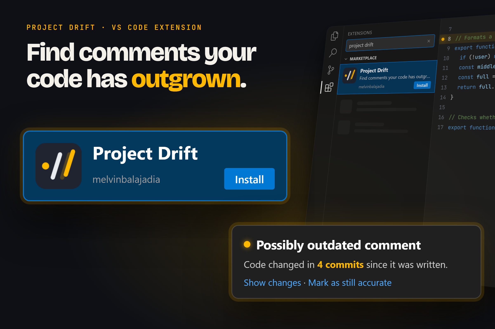
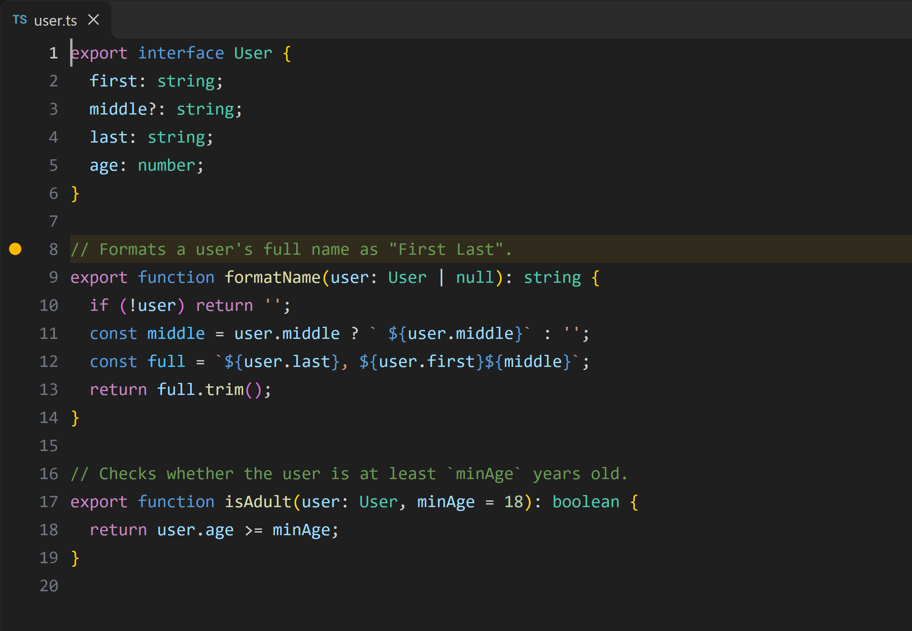
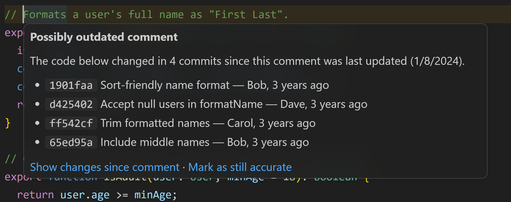
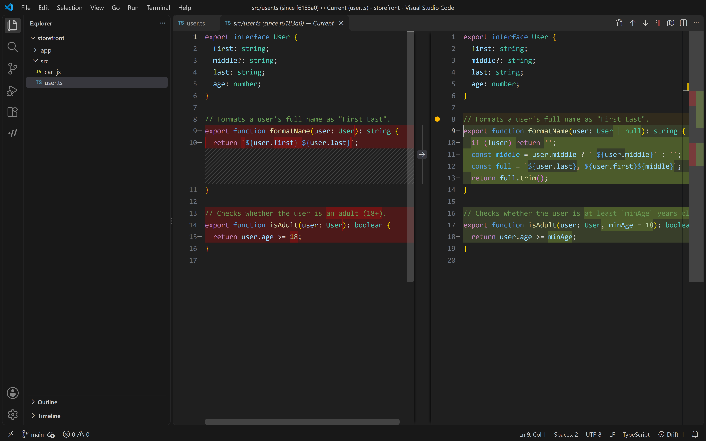
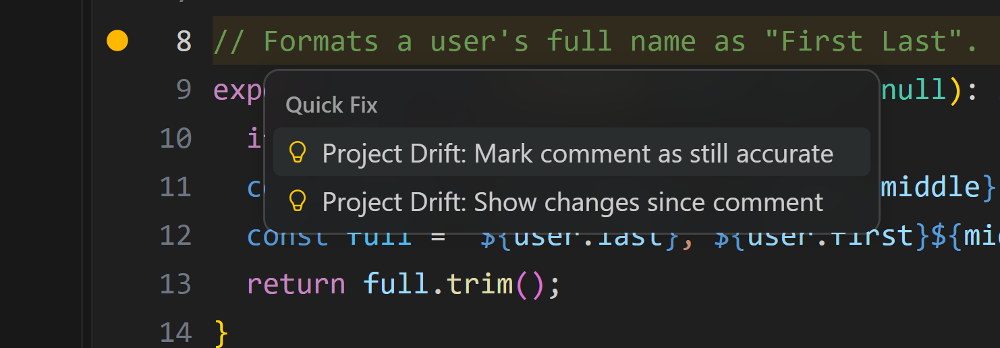
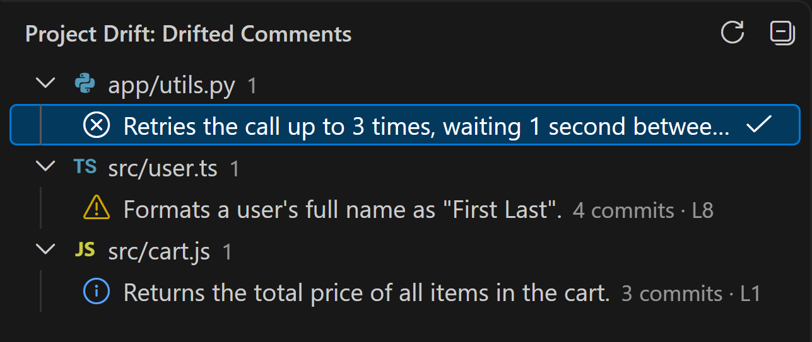

# Project Drift

**Find comments your code has outgrown.**

[](https://marketplace.visualstudio.com/items?itemName=melvinbalajadia.project-drift)
[](https://github.com/melvin-balajadia/project-drift/actions/workflows/ci.yml)
[](LICENSE)



When code changes but the comment above it doesn't, the comment slowly starts to lie. Project Drift reads your git history and flags comments whose code has changed in several commits since the comment was last touched, so you can update them, or confirm they're still right.

▶ **[Watch the demo](https://github.com/melvin-balajadia/project-drift/blob/main/media/project-drift-follow-the-dot.mp4)**

Works with JavaScript, TypeScript (including JSX/TSX), and Python. Runs entirely on your machine: no accounts, no network calls, no telemetry.

## Getting started

1. Install **Project Drift** from the Marketplace, or press `Ctrl+Shift+X` (`Cmd+Shift+X` on macOS) in VS Code and search for "Project Drift".
2. Open a folder that is a git repository with some history.
3. Open a JavaScript, TypeScript, or Python file. Comments whose code has moved on get an amber highlight and a dot in the gutter, and the status bar shows `Drift: N`.
4. Hover a highlighted comment to see which commits changed its code.
5. To see every drifted comment in the project, click the Project Drift icon in the Activity Bar and run **Scan Workspace**.

## Features

### See which comments have drifted

Drifted comments get an amber line highlight, a gutter dot, and a mark in the scrollbar. The status bar shows how many are in the current file.



### Every flag comes with evidence

Hover a flagged comment to see how many commits changed its code since the comment was last updated, with the most recent ones listed: hash, message, author, and date.



### Review exactly what changed

**Show changes since comment** opens a diff of the file as it was when the comment was last updated, next to the current file.



### Fix it or dismiss it

Both actions are in the lightbulb menu (`Ctrl+.` / `Cmd+.`). **Mark as still accurate** hides the warning; it comes back on its own if the comment's code changes again.



### Every drifted comment in one list

The Project Drift view lists drifted comments by file, most outdated first. Click one to jump to it.



Also: an optional **Problems panel** listing (`projectDrift.showInProblems`), and a toggle to hide editor markers.

## How it works

For each full-line comment (`//` or `#`):

1. **Comment.** Find comment blocks: consecutive comment lines with the same indentation. Tool pragmas (`eslint-disable`, `@ts-ignore`, `# noqa`, ...), shebangs, and a license header at the top of the file are skipped.
2. **Scope.** Find the code the comment describes: the function, class, or other symbol that starts right after it, or else the lines below it up to the first blank line or dedent (20 lines at most by default).
3. **Blame.** Run `git blame` to see which commit last changed each line.
4. **Score.** Count the distinct commits that changed that code _after_ the comment was last changed. At or above the threshold (default 2), the comment is flagged.

Severity depends on how far past the threshold the score is: **low** below 2× the threshold, **medium** from 2× to 4×, **high** at 4× or more.

## Settings

| Setting                       | Default                                                     | Description                                                                |
| ----------------------------- | ----------------------------------------------------------- | -------------------------------------------------------------------------- |
| `projectDrift.threshold`      | `2`                                                         | Number of newer commits to a comment's code before the comment is flagged. |
| `projectDrift.maxScopeLines`  | `20`                                                        | Maximum number of code lines considered to belong to a comment.            |
| `projectDrift.showInProblems` | `false`                                                     | Also report drifted comments in the Problems panel.                        |
| `projectDrift.exclude`        | `node_modules`, `dist`, `build`, `vendor`, `*.min.js` globs | Glob patterns to skip during workspace scans.                              |
| `projectDrift.maxFileSizeKB`  | `512`                                                       | Files larger than this are skipped.                                        |

## Commands

| Command                                           | What it does                                                                      |
| ------------------------------------------------- | --------------------------------------------------------------------------------- |
| **Project Drift: Scan Workspace**                 | Analyzes every tracked JS/TS/Python file and fills the sidebar view. Cancellable. |
| **Project Drift: Mark Comment as Still Accurate** | Dismisses the drifted comment at the cursor.                                      |
| **Project Drift: Show Changes Since Comment**     | From a hover, quick fix, or the sidebar: diff since the comment's last update.    |
| **Project Drift: Clear All Dismissals**           | Brings back every dismissed warning (asks first).                                 |
| **Project Drift: Toggle Decorations**             | Hides or shows editor markers. Remembered per workspace.                          |

## Limitations

- **Commit counts are approximate.** `git blame` only records the _last_ commit for each line. A line changed three times counts once, and a commit whose lines were all rewritten later doesn't count at all. The count also says nothing about the size of a change: a typo fix counts the same as a rewrite.
- **Full-line comments only.** Block comments (`/* */`), JSDoc, Python docstrings, and comments at the end of a line of code are not checked.
- **JavaScript, TypeScript, and Python only.**
- **Detection is line-based.** A line starting with `//` or `#` inside a multi-line string is treated as a comment.
- **Scope quality depends on your language support.** TypeScript and JavaScript have symbol support built in. For Python, install a Python language extension (such as Pylance); without one, scope stops at the first blank line, which can miss changes further down a function.
- **Unsaved files are hidden.** Blame describes the file on disk, so markers disappear while a file has unsaved changes and return when you save.
- **After a commit, checkout, or pull,** open files and files that already have drift are re-checked automatically. New drift in other files appears when you open them or on the next scan.
- **Shallow clones** don't have the history needed, so drift is undercounted. You'll see a one-time notice; `git fetch --unshallow` fixes it.
- **Right after VS Code starts,** the first files may take a few seconds to analyze while the TypeScript language server warms up.

## For developers

### Performance

Measured on Windows 11 with full clones and default settings:

| Repository     | History       | Files scanned | First scan | Re-scan, nothing changed |
| -------------- | ------------- | ------------- | ---------- | ------------------------ |
| axios (JS/TS)  | 2,240 commits | 277           | ~33 s      | ~4 s                     |
| flask (Python) | 5,562 commits | 83            | ~8 s       | ~1 s                     |

Most of a first scan is `git blame` and the language server's symbol lookups. Results are cached per file until the file, the repository's HEAD, or a setting changes.

### Design decisions

- **Native VS Code UI, no webview.** Decorations, hovers, quick fixes, a tree view, the status bar, and the built-in diff editor cover everything. They follow every theme (including high contrast), work with the keyboard and screen readers, and cost far less than a webview.
- **The git CLI, run safely.** Git runs via `execFile` with argument arrays, never a shell string, so file names can't inject commands.
- **A pure core.** Parsing and scoring live in `src/core/`, which is not allowed to import `vscode` (enforced by ESLint), so it's unit-tested with plain Vitest.
- **Blame over full history.** Blame is one fast command per file. Walking every line's history (`git log -L`) would give exact counts but cost far more; it's on the backlog as an optional accurate mode.
- **Consistent over fast.** Symbol lookups get a generous timeout rather than a short one. In testing, a short timeout made the same repository report different results from run to run, depending on how fast the language server answered.

### Contributing

You need Node.js 20+ and git.

```sh
npm install
node scripts/make-demo-repo.mjs   # creates demo-repo/ with known fresh and drifted comments
```

Press **F5** in VS Code to launch an Extension Development Host, then open the `demo-repo` folder in it. The header of `scripts/make-demo-repo.mjs` lists what should be flagged.

```sh
npm run lint              # ESLint + Prettier
npm run typecheck
npm run test:unit         # Vitest, with coverage of src/core
npm run test:integration  # runs inside VS Code
npm run package           # builds a .vsix
```

`src/core/` holds the pure logic, `src/git/` the git commands, and `src/vscode/` everything that talks to the editor. Planned work beyond v1.0 is listed in the backlog section of [PLAN.md](PLAN.md).

## License

[MIT](LICENSE)
